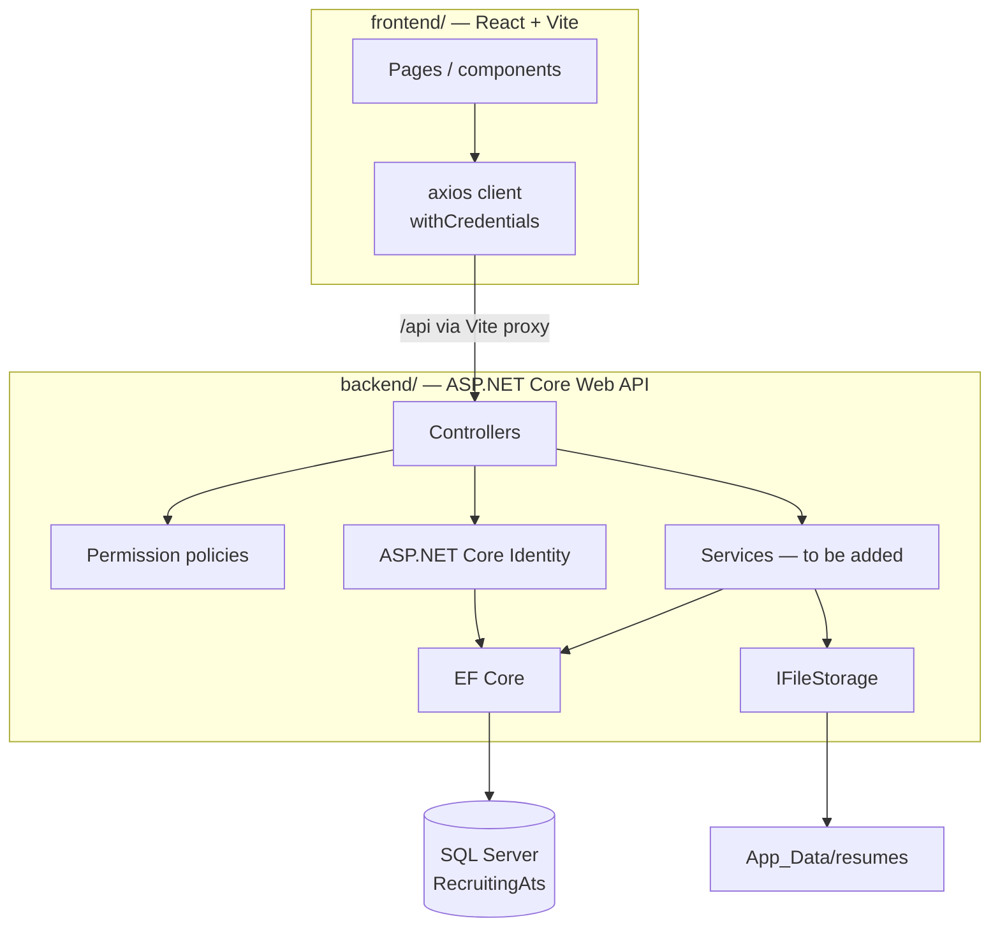
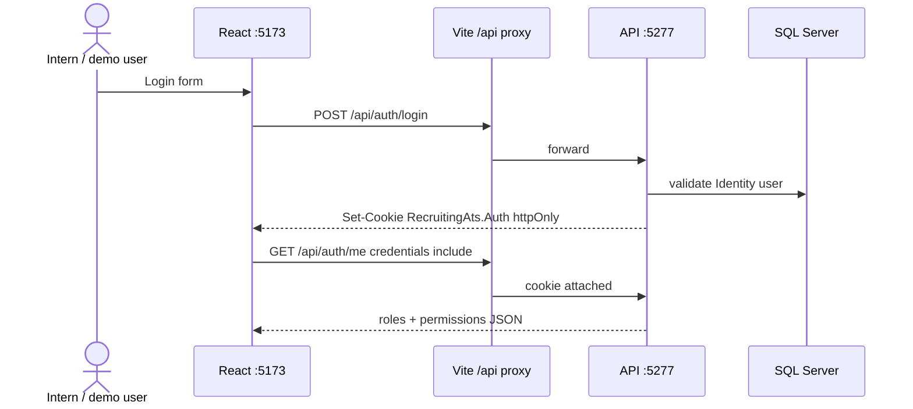
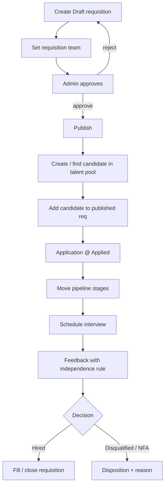

# Recruiting ATS

Team internship project: a simplified **Applicant Tracking System** for managing hiring from **job requisition → talent pool → pipeline → interviews**.

This repo is the shared starting point. Read this document before writing features.

---

## What we are building

Internal recruiting tool (not a public careers site for candidates to self-apply).

Typical flow:

1. Create a requisition (Draft) → set team → **Admin approves** → publish  
2. Recruiter adds candidates to the talent pool (manual details + PDF résumé)  
3. Link a candidate to a published requisition → application starts at **Applied**  
4. Move stages on the pipeline (human-driven only)  
5. Schedule interviews → panel submits feedback (independence rule)  
6. Hire / Disqualify / NFA  

**Scope for now:** Must + Should items from the mentor brief. Could / stretch later.

**Out of scope (do not build unless mentor changes scope):** real AI résumé parsing, real email/calendar sync, separate mobile apps, full analytics, role-admin UI.

---

## Repository layout (Option 1)

```text
RecruitingAts/
├── backend/                 # ASP.NET Core 9 Web API
│   ├── Auth/                # Roles, permissions, policies, claims factory
│   ├── Controllers/         # HTTP endpoints
│   ├── Data/                # DbContext, Identity user, migrations, seeder
│   ├── Storage/             # IFileStorage (PDF résumés on disk)
│   └── Program.cs
├── frontend/                # React + TypeScript + Vite
│   └── src/
│       ├── api/client.ts    # axios + withCredentials
│       └── App.tsx          # temporary auth shell
├── RecruitingAts.sln
└── README.md                # this file
```

There is **no** Razor Views UI. The browser talks to the API; React is the UI.

---

## Architecture



### Auth request path



### High-level hiring workflow (product)



---

## Tech stack (locked)

| Area | Choice |
|------|--------|
| Backend | ASP.NET Core **9** Web API |
| Frontend | React + Vite + TypeScript |
| HTTP client | **axios** (`withCredentials: true`) |
| Auth | ASP.NET Core **Identity** + **httpOnly cookie** |
| Authorization | **Option B** — roles with **permission claims** + policies |
| Database | **SQL Server** + EF Core code-first migrations |
| Files | Local disk via `IFileStorage` (PDF only) |
| UI kit | TBD (shadcn preferred later; plain CSS for now) |

### Dev proxy (important)

In development, React runs on `http://localhost:5173` and proxies `/api` → `http://localhost:5277`.  
That keeps the cookie on one browser origin and avoids painful CORS/CSRF setup.

Configured in `frontend/vite.config.ts`.

---

## Prerequisites

Install on your machine:

1. **[.NET 9 SDK](https://dotnet.microsoft.com/download)**  
2. **[Node.js LTS](https://nodejs.org/)** (20+)  
3. **SQL Server Express** (or full SQL Server)  
4. Git  
5. IDE: Visual Studio 2022, VS Code, or Rider  

Optional: Azure Data Studio / SSMS to inspect the database.

Check versions:

```powershell
dotnet --version
node --version
npm --version
```

EF tools (once per machine):

```powershell
dotnet tool install --global dotnet-ef
# or update:
dotnet tool update --global dotnet-ef
```

---

## Clone and first-time setup

```powershell
git clone <repo-url>
cd RecruitingAts
```

### 1. Database connection string

Edit `backend/appsettings.json`:

```json
"ConnectionStrings": {
  "DefaultConnection": "Server=localhost\\YOUR_INSTANCE;Database=RecruitingAts;Trusted_Connection=True;TrustServerCertificate=True;MultipleActiveResultSets=true"
}
```

Examples:

| Instance | Connection server value |
|----------|-------------------------|
| Named Express | `localhost\\SQLEXPRESS` |
| This seed machine | `localhost\\SQLEXPRESS03` |
| LocalDB (if installed) | `(localdb)\\mssqllocaldb` |

Find running instances (PowerShell):

```powershell
Get-Service *SQL* | Format-Table Name, Status
```

### 2. Restore & migrate

Migrations also run automatically on API startup via `DbSeeder`, but you can apply manually:

```powershell
cd backend
dotnet restore
dotnet ef database update
cd ..
```

### 3. Frontend packages

```powershell
cd frontend
npm install
cd ..
```

---

## Run locally (every day)

**Terminal 1 — API**

```powershell
cd backend
dotnet run --launch-profile http
```

API: `http://localhost:5277`

**Terminal 2 — React**

```powershell
cd frontend
npm run dev
```

UI: `http://localhost:5173`

Open the UI, pick a demo account button, log in. You should see **roles** and **permissions** for that user.

---

## Seeded demo users

Created automatically on API startup (`backend/Data/DbSeeder.cs`).

| Email | Password | Role | Purpose |
|-------|----------|------|---------|
| `admin@demo.local` | `Pass123!` | **Admin** | Approvals, all permissions, compensation |
| `recruiter@demo.local` | `Pass123!` | **Recruiter** | Day-to-day hiring work |
| `manager@demo.local` | `Pass123!` | **HiringManager** | Own / manage requisitions |
| `interviewer@demo.local` | `Pass123!` | **Interviewer** | Feedback only |

Self-register via the UI creates a user **without** a demo role (fine for tinkering; use seeded accounts for demos).

---

## Roles and permissions (Option B)

We do **not** hard-code role names in every controller.  
We seed **roles**, attach **permission claims** to those roles, and protect endpoints with **policies**.

Claim type: `permission`  
Example policy usage:

```csharp
[Authorize(Policy = Permissions.CompensationView)]
```

Constants live in `backend/Auth/Permissions.cs`.

### Permission matrix (seeded)

| Permission | Admin | Recruiter | HiringManager | Interviewer |
|------------|:-----:|:---------:|:-------------:|:-----------:|
| `REQUISITIONS.ALL_REQS.VIEW` | ✓ | | | |
| `REQUISITIONS.MANAGE` | ✓ | ✓ | ✓ | |
| `REQUISITIONS.APPROVE` | ✓ | | | |
| `ATS.COMPENSATION.VIEW` | ✓ | | | |
| `ATS.COMPENSATION.EDIT` | ✓ | | | |
| `POOL.VIEW` | ✓ | ✓ | ✓ | |
| `CANDIDATES.MANAGE` | ✓ | ✓ | ✓ | |
| `APPLICATIONS.MANAGE` | ✓ | ✓ | ✓ | |
| `INTERVIEWS.SCHEDULE` | ✓ | ✓ | ✓ | |
| `INTERVIEWS.FEEDBACK.ADD` | ✓ | ✓ | | ✓ |
| `STAGES.MANAGE` | ✓ | | | |
| `USERS.MANAGE` | ✓ | | | |

**Approver decision (locked):** requisition approval is done by **Admin** (`REQUISITIONS.APPROVE`).

### Still required later (not the same as roles)

- **Requisition scope:** non-admins only see requisitions they are on the team for  
- **Compensation:** omit fields unless permitted; audit every view  
- **Feedback independence:** interviewer cannot see others’ feedback until they submit their own  

Frontend may hide buttons using `user.permissions`, but **server must enforce** every rule.

---

## Current API surface

| Method | Path | Auth | Notes |
|--------|------|------|-------|
| GET | `/api/health` | Anonymous | Liveness |
| POST | `/api/auth/register` | Anonymous | Creates user, signs in (no seeded role) |
| POST | `/api/auth/login` | Anonymous | Sets httpOnly cookie |
| POST | `/api/auth/logout` | Authenticated | Clears cookie |
| GET | `/api/auth/me` | Authenticated | `{ id, email, fullName, roles, permissions }` |
| GET | `/api/debug/compensation` | `ATS.COMPENSATION.VIEW` | Policy smoke test |

Quick API checks (with cookie jar) once logged in from the browser, or use the React shell.

---

## Git workflow

- Branch from `master` (or `main` if renamed): `feature/<short-name>`  
- Small PRs; at least one teammate review  
- Do **not** commit:
  - `bin/`, `obj/`, `node_modules/`, `dist/`
  - local secrets / `*.local.md`
  - uploaded résumés under `App_Data/resumes/` (except `.gitkeep`)

### Local-only notes

Product decisions that are still open are tracked in a **gitignored** file on your machine:

```text
DOMAIN_DECISIONS.local.md
```

Copy from a teammate or recreate locally if missing. **Never commit it.**

---

## Project conventions

1. **Business rules in C# services** (when added) — not only in React.  
2. Controllers stay thin.  
3. New permissions → add to `Permissions.All`, seeder matrix, and a policy (policies are registered automatically from `Permissions.All`).  
4. PDF résumés only; use `IFileStorage`.  
5. Do not log PII (emails/phones in plain logs).  
6. Prefer Must/Should features over polish until the hiring flow works end-to-end.

---

## Troubleshooting

| Problem | What to try |
|---------|-------------|
| API fails on startup / migrate | Check SQL service is **Running**; fix instance name in connection string |
| Login works but next API call is 401 | Ensure axios `withCredentials: true` and you use the Vite URL (`5173`), not calling `:5277` from the browser without CORS cookies |
| CORS errors | Use the proxy (`/api/...`), don’t hardcode `http://localhost:5277` in the frontend |
| Permissions empty after changing seeder | Restart API; **log out and log in again** (cookie claims refresh on sign-in) |
| `dotnet ef` not found | Install global tool (see Prerequisites) |
| Port 5277 / 5173 in use | Stop the other process or change ports in `launchSettings.json` / `vite.config.ts` (keep proxy target in sync) |

---

## Demo checklist (as features land)

- [ ] Admin logs in → sees all permissions  
- [ ] Interviewer logs in → limited permissions; compensation probe fails  
- [ ] Create requisition → Admin approves → publish  
- [ ] Create candidate + PDF → duplicate warning on email/phone  
- [ ] Add to requisition → move stages → disposition with reason  
- [ ] Schedule interview → submit feedback → independence rule  
- [ ] Compensation visible only with permission + audited  

---

## Where to look in code

| Concern | Location |
|---------|----------|
| Permission names | `backend/Auth/Permissions.cs` |
| Role names | `backend/Auth/AppRoles.cs` |
| Policy registration | `backend/Auth/AuthorizationExtensions.cs` |
| Cookie claims | `backend/Auth/AppClaimsPrincipalFactory.cs` |
| Seed users / role claims | `backend/Data/DbSeeder.cs` |
| Login / me DTOs | `backend/Controllers/AuthController.cs` |
| axios helper | `frontend/src/api/client.ts` |
| Connection string | `backend/appsettings.json` |

---

## Questions?

Ask the mentor for business-rule edge cases.  
Use team chat / GitHub Issues for task assignment.  
Keep unfinished domain decisions in `DOMAIN_DECISIONS.local.md` (local only).
