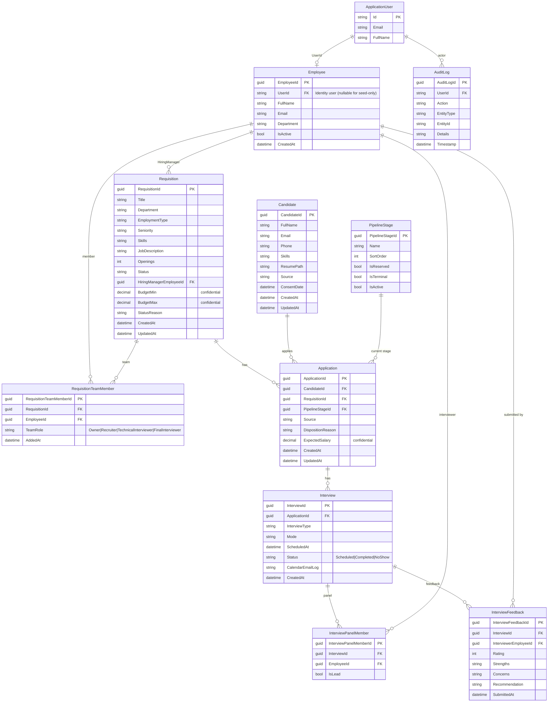

# Recruiting ATS — Canonical ERD

Working data model for implementation. Based on the mentor brief + locked team decisions.

**Stack note:** Login users live in ASP.NET Identity tables (`AspNetUsers`, roles, claims). Domain `Employee` links to Identity via `UserId`. Permissions are **not** ERD entities (Option B: role claims / policies).

**Working defaults** (use until the team/mentor overrides): one Employee per seeded user; stages Screening / Interview / Offer; requisition statuses below; skills as simple strings; source + consent + interview status included (Should).

---

## Locked decisions reflected here

| Decision | How it shows in the model |
|----------|---------------------------|
| Approver = Admin | No Approver table — approval is a status transition authorized by `REQUISITIONS.APPROVE` |
| Option B permissions | No Employee.Role for app auth — Identity roles/permissions handle that |
| Team roles | `RequisitionTeamMember.TeamRole` only |
| Candidate ≠ Application | Separate tables; Application links person to one requisition |
| Compensation confidential | `Requisition.BudgetMin/Max`, `Application.ExpectedSalary` — gated in services, audited |
| Disposition reason | `Application.DispositionReason` (string) when stage is Disqualified/NFA |
| Source | String on Candidate and Application (no extra lookup table for v1) |
| Feedback independence | Rule in services — Feedback rows still stored normally |
| Scope | Query filter on team membership / Admin permission — not a table |

---

## Diagram

---

## Relationships (cardinalities)

| From | To | Cardinality | Notes |
|------|-----|-------------|--------|
| ApplicationUser | Employee | 1 ↔ 0..1 | Prefer 1:1 for app users who act in ATS |
| Employee | Requisition (as HiringManager) | 1 → * | `HiringManagerEmployeeId` |
| Requisition | RequisitionTeamMember | 1 → * | Exactly **one** Owner enforced in service |
| Employee | RequisitionTeamMember | 1 → * | Same person on many reqs |
| Candidate | Application | 1 → * | One person, many jobs |
| Requisition | Application | 1 → * | Only when Status = Published (service rule) |
| PipelineStage | Application | 1 → * | Current stage |
| Application | Interview | 1 → * | |
| Interview | InterviewPanelMember | 1 → * | At most one `IsLead = true` (service) |
| Interview | InterviewFeedback | 1 → * | One active feedback per interviewer (service) |
| Employee | InterviewFeedback | 1 → * | Interviewer |

**Unique suggestions (enforce in EF / DB):**

- `RequisitionTeamMember (RequisitionId, EmployeeId)` unique  
- `Application (CandidateId, RequisitionId)` unique  
- `InterviewPanelMember (InterviewId, EmployeeId)` unique  
- `InterviewFeedback (InterviewId, InterviewerEmployeeId)` unique  
- `Candidate.Email` unique (supports duplicate detection)  
- Consider unique filtered index on `Candidate.Phone` when not null/empty  

---

## Enumerations / allowed values

### Requisition.Status
`Draft` → `PendingApproval` → `Published` → (`OnHold` \| `Filled` \| `Closed` \| `Cancelled`)  
Reject approval → back to `Draft` (with comment in `StatusReason` or audit details).

### RequisitionTeamMember.TeamRole
`Owner` | `Recruiter` | `TechnicalInterviewer` | `FinalInterviewer`

### PipelineStage seed (SortOrder)

| Name | SortOrder | IsReserved | IsTerminal |
|------|-----------|------------|------------|
| Applied | 1 | true | false |
| Screening | 2 | false | false |
| Interview | 3 | false | false |
| Offer | 4 | false | false |
| Hired | 100 | true | true |
| Disqualified | 101 | true | true |
| NFA | 102 | true | true |

Admin may add more **working** (non-reserved) stages later.

### Interview.Status
`Scheduled` | `Completed` | `NoShow`

### Interview.Mode (examples)
`Onsite` | `Video` | `Phone`

### Interview.InterviewType (examples)
`Technical` | `Final` | `HR` | `Other`

### Source (Candidate / Application)
Free string or constrained set, e.g. `Referral` | `CareersPage` | `Agency` | `LinkedIn` | `Other`

---

## Entity field reference

### Employee
| Field | Type | Notes |
|-------|------|--------|
| EmployeeId | Guid PK | |
| UserId | string? FK | AspNetUsers.Id |
| FullName | string | |
| Email | string | |
| Department | string | |
| IsActive | bool | |
| CreatedAt | DateTime | |

### Requisition
| Field | Type | Notes |
|-------|------|--------|
| RequisitionId | Guid PK | |
| Title | string | |
| Department | string | |
| EmploymentType | string | e.g. FullTime |
| Seniority | string | |
| Skills | string | Comma/tag list for v1 |
| JobDescription | string | |
| Openings | int | |
| Status | string | See enum |
| HiringManagerEmployeeId | Guid FK | |
| BudgetMin / BudgetMax | decimal? | Confidential |
| StatusReason | string? | Hold/close/cancel/reject comment |
| CreatedAt / UpdatedAt | DateTime | |

### RequisitionTeamMember
| Field | Type | Notes |
|-------|------|--------|
| RequisitionTeamMemberId | Guid PK | |
| RequisitionId | Guid FK | |
| EmployeeId | Guid FK | |
| TeamRole | string | See enum |
| AddedAt | DateTime | |

### Candidate
| Field | Type | Notes |
|-------|------|--------|
| CandidateId | Guid PK | |
| FullName | string | |
| Email | string | Unique; duplicate key |
| Phone | string? | Duplicate key when present |
| Skills | string? | Simple list for v1 |
| ResumePath | string? | Relative path via IFileStorage |
| Source | string? | Should |
| ConsentDate | DateTime? | Should |
| CreatedAt / UpdatedAt | DateTime | |

### PipelineStage
| Field | Type | Notes |
|-------|------|--------|
| PipelineStageId | Guid PK | |
| Name | string | |
| SortOrder | int | |
| IsReserved | bool | Cannot delete/rename freely |
| IsTerminal | bool | Hired / Disqualified / NFA |
| IsActive | bool | |

### Application
| Field | Type | Notes |
|-------|------|--------|
| ApplicationId | Guid PK | |
| CandidateId | Guid FK | |
| RequisitionId | Guid FK | |
| PipelineStageId | Guid FK | Starts at Applied |
| Source | string? | Should |
| DispositionReason | string? | Required for Disqualified/NFA |
| ExpectedSalary | decimal? | Confidential |
| CreatedAt / UpdatedAt | DateTime | |

### Interview
| Field | Type | Notes |
|-------|------|--------|
| InterviewId | Guid PK | |
| ApplicationId | Guid FK | |
| InterviewType | string | |
| Mode | string | |
| ScheduledAt | DateTime | |
| Status | string | |
| CalendarEmailLog | string? | Simulated send log |
| CreatedAt | DateTime | |

### InterviewPanelMember
| Field | Type | Notes |
|-------|------|--------|
| InterviewPanelMemberId | Guid PK | |
| InterviewId | Guid FK | |
| EmployeeId | Guid FK | Must be on req interviewer team (service) |
| IsLead | bool | ≤ 1 per interview |

### InterviewFeedback
| Field | Type | Notes |
|-------|------|--------|
| InterviewFeedbackId | Guid PK | |
| InterviewId | Guid FK | |
| InterviewerEmployeeId | Guid FK | |
| Rating | int | |
| Strengths | string | |
| Concerns | string | |
| Recommendation | string | |
| SubmittedAt | DateTime | |

### AuditLog
| Field | Type | Notes |
|-------|------|--------|
| AuditLogId | Guid PK | |
| UserId | string | Identity user id |
| Action | string | e.g. CompensationViewed, StageMoved |
| EntityType | string | |
| EntityId | string | |
| Details | string | JSON or text; avoid raw PII dumps |
| Timestamp | DateTime | |

---

## Out of ERD (by design)

| Concern | Where it lives |
|---------|----------------|
| Roles / permissions | Identity + `Permissions` claims |
| Requisition visibility scope | `IRequisitionScopeService` |
| Compensation hide + audit | Guard + AuditLog |
| Feedback independence | Interview feedback queries |
| Duplicate warn UX | Candidate service before insert |
| PDF size/type rules | `IFileStorage` |
| Match score / tags / offers | Stretch — not in v1 model |

---

## Implementation order (entities)

1. Employee (+ seed linked to demo users)  
2. PipelineStage (+ seed)  
3. Requisition + RequisitionTeamMember  
4. Candidate  
5. Application  
6. Interview + InterviewPanelMember + InterviewFeedback  
7. AuditLog  

---

## Review checklist for the team

- [ ] Agree Guids for all domain PKs  
- [ ] Confirm working stage names (Screening / Interview / Offer)  
- [ ] Confirm skills as single string is OK for v1  
- [ ] Confirm no separate DispositionReason / ApplicationSource tables  
- [ ] Mentor sign-off before large parallel migrations  
